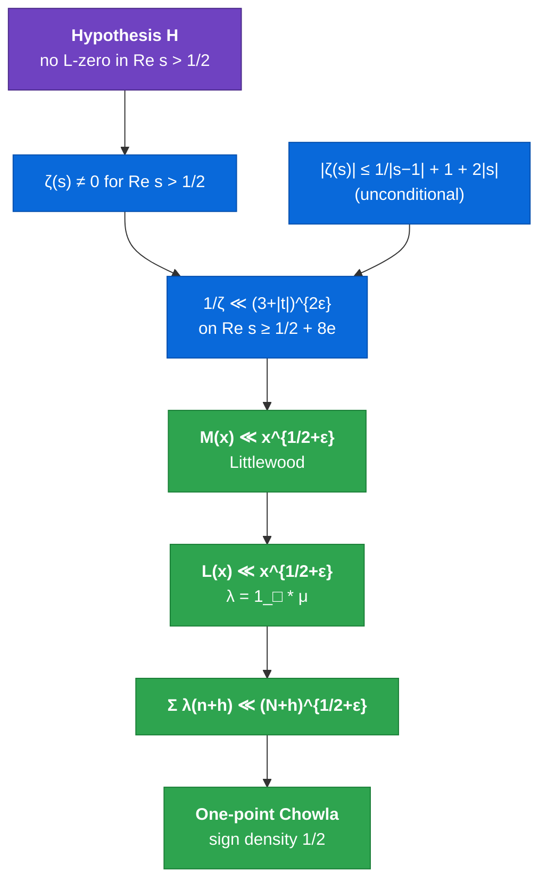

<div align="center">

# 🎲 averaged-chowla-grh

### The Liouville function and the one-point Chowla conjecture under the Riemann hypothesis

[](lean-toolchain)
[](lake-manifest.json)
[](axioms.txt)
[-d73a49)](LiouvilleEnergyRH/Hypothesis.lean)
[](Axioms.lean)
[](AveragedChowla.lean)
[](https://github.com/anaxia-research/liouville-energy-rh)

</div>

---

> **Paper.** D. Bhattacharjee and U. Bhattacharya, *The Riemann Hypothesis and Its Generalization as One Energy Bound*, preprint, 2026.
>
> **Parent repository.** [anaxia-research/liouville-energy-rh](https://github.com/anaxia-research/liouville-energy-rh), the full Lean formalization of the paper.



🟣 **Parent conjecture:** the generalized Riemann hypothesis for Dirichlet L-functions, in the form of Hypothesis H: no Dirichlet L-function vanishes in Re s > 1/2. Only its case q = 1, the Riemann hypothesis, is used here.

🎯 **Statement.** For every ε > 0:

- M(x) = Σ_{n≤x} μ(n) ≪ x^{1/2+ε} and L(x) = Σ_{n≤x} λ(n) ≪ x^{1/2+ε};
- |Σ_{n≤N} λ(n+h)| ≤ C (N+h)^{1/2+ε}, uniformly in the shift h;
- (1/N) Σ_{n≤N} λ(n+h) → 0 for every h, and each sign of λ(n+h) has natural density 1/2.

✅ **Lean 4 declarations:**

| Declaration | Statement |
|---|---|
| `LiouvilleEnergyRH.ZetaBound.norm_riemannZeta_le` | ‖ζ(s)‖ ≤ 1/‖s−1‖ + 1 + 2‖s‖ for Re s ≥ 1/2, s ≠ 1 (unconditional) |
| `LiouvilleEnergyRH.Mertens.invZeta_bound` | bound for 1/ζ on vertical strips, from the zero-free half-plane |
| `LiouvilleEnergyRH.Mertens.mertens_bound` | ‖Σ_{n≤x} μ(n)‖ ≤ K x^{1/2+η}, from the zero-free half-plane |
| `LiouvilleEnergyRH.littlewoodRH_of_H` | Hypothesis H ⟹ `ChowlaRH.LittlewoodRH` |
| `LiouvilleEnergyRH.liouvilleBound_of_H` | Hypothesis H ⟹ L(N) ≪ N^{1/2+ε} |
| `LiouvilleEnergyRH.shifted_sum_bound` | Hypothesis H ⟹ Σ λ(n+h) ≪ (N+h)^{1/2+ε} |
| `LiouvilleEnergyRH.chowla_one_of_H` | Hypothesis H ⟹ Chowla of order 1 (natural averages) |
| `LiouvilleEnergyRH.two_point_shift_average` | Hypothesis H ⟹ Σ_{h≤H} Σ_{n≤N} λ(n)λ(n+h) ≪ N (N+H)^{1/2+ε} |
| `LiouvilleEnergyRH.two_point_square_average` | Hypothesis H ⟹ Σ_{h≤N} Σ_{n≤N} λ(n)λ(n+h) ≪ N^{3/2+ε} |
| `LiouvilleEnergyRH.sign_density_of_H` | Hypothesis H ⟹ λ(n+h) = ±1 each with density 1/2 |
| `ChowlaRH.logPattern_le_three` | sign patterns of length ≤ 3 from the cited theorems of Tao and Tao–Teräväinen (named hypotheses) |

`lake env lean Axioms.lean` prints only `propext`, `Classical.choice` and `Quot.sound` for each (see `axioms.txt`). There is no `sorry`, `axiom` or `native_decide` in the sources.

## 🔧 Build

```
lake exe cache get
lake build
lake env lean Axioms.lean
```

Lean v4.34.1, Mathlib v4.34.1.

## 🙏 Context and credit

This is one corollary of the paper *The Riemann Hypothesis and Its Generalization as One Energy Bound* by D. Bhattacharjee and U. Bhattacharya. The full formalization is at [anaxia-research/liouville-energy-rh](https://github.com/anaxia-research/liouville-energy-rh). The transfer from μ to λ and the sign-pattern expansion come from [anaxia-research/chawla-rh](https://github.com/anaxia-research/chawla-rh). Hypothesis H is stated word for word as `DirichletLNonvanishingRightOfHalf` in L. Alpöge's Lean project (alpo.ge, November 2026). Third-party sources are listed in [`NOTICE`](NOTICE): the library `Vinogradov/` (creelie/breakthrough-problems-3, Apache 2.0), OpenAI's `LogarithmicControl.lean` (Apache 2.0), and the Selberg sieve from PrimeNumberTheoremAnd (Apache 2.0).

## 📖 Citation

```bibtex
@misc{BhattacharjeeBhattacharya2026,
  author = {Bhattacharjee, Deep and Bhattacharya, U.},
  title  = {The Riemann Hypothesis and Its Generalization as One Energy Bound},
  year   = {2026},
  note   = {Preprint. Lean formalization: https://github.com/anaxia-research/liouville-energy-rh}
}
```
